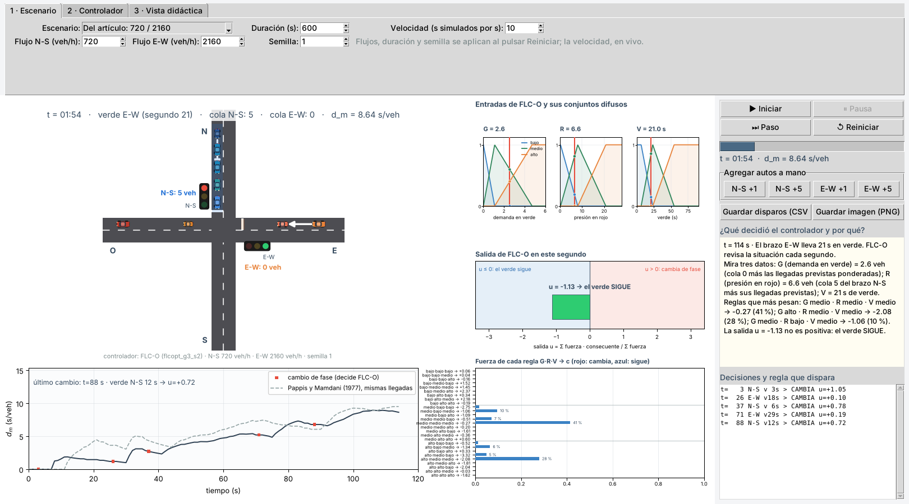
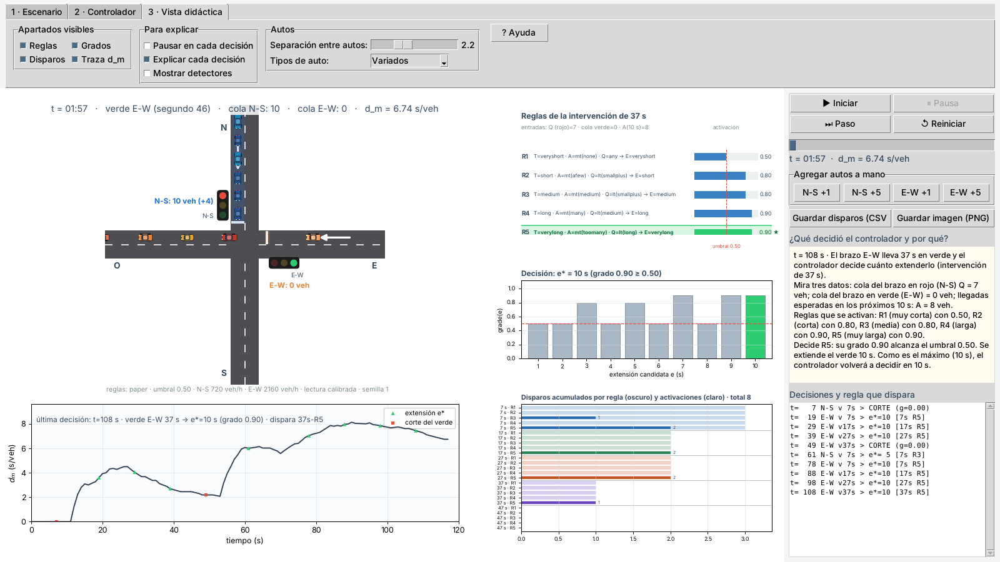

# Mejora de un controlador de semáforos de lógica difusa: optimización del controlador de Pappis y Mamdani (1977)

Este repositorio mejora, mediante optimización, el controlador de semáforos con lógica difusa de

> C. P. Pappis y E. H. Mamdani, «A Fuzzy Logic Controller for a Traffic Junction»,
> *IEEE Trans. Syst., Man, Cybern.*, vol. SMC-7, no. 10, pp. 707–717, oct. 1977.

Parte de la réplica de ese controlador hecha antes por los autores (carpeta `articulo_replica/`), que sirve de línea base y de validación del
simulador. El resultado es **FLC-O**, un controlador difuso de 27 reglas y 42 parámetros que decide cada segundo si cambiar de fase; sus
parámetros se entrenan con CMA-ES sobre caudales sorteados y se prueban en conjuntos que no se usaron para entrenar, con una medida del
retardo que cuenta toda la espera hasta el final del horizonte.

> **Autores:** Raul Nolberto Quispe Saya y Kevin Luis Valero Ccacya
> Escuela Profesional de Ingeniería Electrónica, Universidad Nacional de San Agustín de Arequipa.

## Resultados

Retardo medio en s/veh, con la vista adelante de 10 s (llegadas de los próximos 10 s) que supone el modelo original:

| Conjunto de prueba | Pappis y Mamdani | Actuado afinado | FLC-O | FLC-O frente a Pappis | FLC-O frente al actuado afinado |
|---|---|---|---|---|---|
| Oficial (16 pares de la Tabla VIII × 20 réplicas) | 10.95 | 9.63 | 7.91 | −27.8 % | −17.8 % |
| 64 caudales no vistos | 10.40 | 9.17 | 7.40 | −28.8 % | −19.3 % |
| Demanda variable | 8.65 | 8.07 | 6.07 | −29.8 % | −24.7 % |
| Cerca de la saturación | 105.87 | 24.13 | 24.29 | −77.1 % | +0.7 % (empate) |

En el conjunto oficial FLC-O es significativamente mejor que Pappis y Mamdani y que el actuado afinado en los 16 pares (Wilcoxon pareado con
Holm) y no es peor en ninguno. Para ciclo fijo de Webster da 13.81 y la política óptima por programación dinámica con caudales conocidos, 9.35.

**Límites** (el artículo los declara en la Sección IX):

1. La mejora depende de la vista adelante de 10 s, que es un supuesto del modelo original. Sin ella, el difuso causal queda 3.5 % peor que el actuado
   afinado (9.97 frente a 9.63) y la mejor variante causal, una política neuronal, lo mejora solo 1.7 % (9.46).
2. Cerca de la saturación FLC-O empata con el actuado afinado; no lo supera.
3. Todo es simulación de una intersección aislada con llegadas de Bernoulli; no hay datos de campo.
4. El mejor resultado usa un verde mínimo de 3 s; con 5 s el retardo oficial es 8.21 y con 7 s, 8.60.
5. El retardo corregido (con espera residual) no es comparable con el de la Tabla VIII del original.

## Qué contiene

| Carpeta | Contenido |
|---|---|
| `articulo/` | **Artículo** de la mejora (`main.tex`, 9 páginas) y su suplemento (`suplemento.tex`, 3 páginas), con sus PDF, tablas, figuras y `referencias.bib`. Listo para Overleaf. |
| `codigo/` | Simulador vectorizado (`sim_batch.py`), controladores y entrenamiento (`opt_*.py`), **simulador interactivo con calle y autos** (`simulador_gui.py`, `web_sim.py`), generadores de tablas y figuras (`gen_*_opt.py`), comparador visual (`simulador_opt.py`), pruebas, y el modelo de la réplica. |
| `resultados/opt/` | Modelos entrenados (`modelos_finales.json` indica cuál es cuál), referencias afinadas y `evaluacion_final.json`, de donde salen todas las cifras del artículo. |
| `entregas/` | Matriz de respuesta del autor (DOCX y PDF). |
| `articulo_replica/` | Artículo y suplemento de la réplica del controlador de 1977 (15 y 9 páginas), antecedente de este trabajo. |
| `resultados/` (raíz) | Resultados de la réplica en JSON (Tablas I y VIII, auditoría, estadística) y las 180 reglas en `reglas_180.csv`. |
| `figures/`, `muestras/`, `notebooks/` | Figuras, ejemplos y cuaderno de la réplica. |
| `docs/` | Guía técnica (`README_TECNICO.md`), guía de VS Code y el PDF del avance 5 de la réplica. |
| `.vscode/` | Configuraciones de F5 y tareas para ejecutar todo desde Visual Studio Code. |
| `referencia/` | Cita del artículo original (el PDF no se incluye: pertenece a IEEE). |
| `archivo/` | Material histórico, no vigente. |

La rama `replica` conserva el estado anterior del repositorio, centrado solo en la réplica.

## Instalación

Se necesita Python 3.10 o superior (el simulador de ventana usa Tkinter). Con Python 3.13 y NumPy 2.5 se obtuvieron los resultados
(`requirements-resultados.txt`).

```bash
# Linux / macOS (en Ubuntu: sudo apt install python3-venv python3-tk)
python3 -m venv .venv
source .venv/bin/activate
python -m pip install -r requirements.txt
```

```powershell
# Windows (PowerShell); si "python" no se reconoce, use "py" en su lugar
py -m venv .venv
Set-ExecutionPolicy -Scope Process -ExecutionPolicy Bypass
.venv\Scripts\activate
python -m pip install -r requirements.txt
```

## Cómo usarlo

```bash
python codigo/ejecutar_pruebas.py       # todas las comprobaciones (unos 30 s)
python codigo/simulador_gui.py          # SIMULADOR INTERACTIVO: calle, autos y semáforos con FLC-O (ventana)
python codigo/simulador_gui.py --controlador pappis   # el mismo, con el controlador de 1977 y sus 25 reglas
python codigo/web_sim.py                # el mismo en el navegador: http://localhost:8000
python codigo/simulador_opt.py          # compara Pappis y Mamdani con FLC-O sobre las mismas llegadas (figura o GIF)
python codigo/simulador_opt.py --gif salidas/comparacion.gif --guardar salidas/comparacion.png --sin-ventana
python codigo/opt_evaluacion_final.py   # evaluación completa en los cuatro conjuntos de prueba (varios minutos)
python codigo/gen_tablas_opt.py && python codigo/gen_fig_opt.py   # regenera tablas, cifras del texto y figuras del artículo
python codigo/opt_entrenar_modelo.py --modelo flcopt --gmin 3 --max-green 90 --suma-max 3300 --ref actuado_af --out resultados/opt/mi_modelo.json
```

### El simulador interactivo

La ventana (Tkinter) y la versión web dibujan la intersección con autos que avanzan, frenan y respetan la distancia entre sí, y semáforos de
tres luces. Se elige el controlador (FLC-O o Pappis y Mamdani), los flujos, la semilla y la velocidad; se pueden agregar autos a mano y se
ve en vivo, en la traza de retardo, la curva punteada **del otro controlador sobre las mismas llegadas**. Con FLC-O se muestran, en cada
segundo, sus entradas G, R y V sobre sus conjuntos difusos, la salida u y la fuerza de cada una de sus 27 reglas, y una explicación en palabras
de lo que decide; con el controlador de 1977, las 5 reglas de cada intervención y su regla que dispara.



Entrenar FLC-O tarda unos 15 minutos con 4 núcleos. Los scripts se pueden ejecutar desde cualquier carpeta. En Visual Studio Code, abra la
carpeta y use **Ejecutar y depurar (F5)**; `docs/README_VSCODE.md` explica el paso a paso, incluidas las configuraciones 7 a 9 de la mejora.

### Artículo

`articulo/` contiene el manuscrito (`main.tex`, 9 páginas con referencias, IEEEtran), el material suplementario (`suplemento.tex`: configuración
del entrenamiento, referencias afinadas, verificación del simulador, cota por programación dinámica, resultados completos por par y sensibilidad a la
semilla de entrenamiento) y `referencias.bib`. En Overleaf: suba la carpeta como proyecto, deje `main.tex` como documento principal y compile con
pdfLaTeX y BibTeX. Las tablas y las cifras del texto no se escriben a mano: las genera `codigo/gen_tablas_opt.py` desde `resultados/opt/*.json`
(`numeros.tex`, `tabla_*.tex`), y las figuras, `codigo/gen_fig_opt.py`. La matriz de respuesta se genera con `python codigo/gen_matriz_opt.py`
después de compilar el artículo.

## Pruebas

`python codigo/ejecutar_pruebas.py` corre 192 comprobaciones automáticas (60 de la mejora y 132 de la réplica):

| Prueba | Qué verifica |
|---|---|
| `test_sim_batch.py` (10) | El simulador vectorizado reproduce exactamente al de referencia (6 controladores, 2 convenciones de retardo). |
| `test_opt.py` (11) | CMA-ES, partición de Ruspini, programación dinámica, FLC-O y Pappis y Mamdani afinado. |
| `test_sim_flco.py` (27) | El simulador interactivo con FLC-O (motor paso a paso, vista, CSV y web) reproduce exactamente al simulador por lotes; respeta el verde mínimo y máximo; la vista dibuja las 27 reglas, la salida u y la curva de referencia. Con `--gui` prueba además la ventana Tk. |
| `test_archivos_citados_opt.py` (12) | Todo archivo citado por el artículo y el suplemento de la mejora existe. |
| `test_paper_tables.py` (42) | Réplica: conjuntos, operadores, las 25 reglas, ejemplo de la Tabla VII y estructura temporal frente a lo impreso. |
| `test_sim_engine.py` (10) | Réplica: el simulador paso a paso da el mismo resultado que la simulación por lotes. |
| `test_disparos.py` (22) | Réplica: el panel de reglas y disparos muestra lo que calcula el controlador. |
| `test_autos.py` (13) | Réplica: los autos nunca se superponen, apagar reglas afecta el resultado y las explicaciones coinciden con las decisiones. |
| `test_parametros.py` (14) | Réplica: las lecturas de las entradas A y Q son explícitas y ningún parámetro se ignora; `mt`/`lt` coinciden con la Tabla V. |
| `test_estadistica.py` (10) | Wilcoxon, Friedman, Holm, t de Student y χ² contra valores conocidos. |
| `verificar_formulas.py` (9) | Las deducciones matemáticas contra cálculos independientes. |
| `test_archivos_citados.py` (12) | Todo script, JSON, CSV y fuente LaTeX citado por el artículo de la réplica existe y compila. |
| `verificar_referencias.py` | Comprueba cada DOI de `referencias.bib` contra Crossref (requiere internet; no cuenta entre las comprobaciones). |

Con `--rapido` recalcula además una Tabla VIII reducida de la réplica (unos 20 s).

## Antecedente: la réplica del controlador de 1977

El controlador original decide, cada 10 s de verde, cuánto extender la luz verde de una intersección aislada de dos calles unidireccionales.
La réplica **usa las 25 reglas exactas del artículo original** (5 por cada intervención, a los 7, 17, 27, 37 y 47 s), leídas de la imagen de
las páginas del original y verificadas por pruebas automáticas. Con 20 réplicas de 7200 s por combinación de flujos y números aleatorios comunes
(la réplica *k* usa la semilla *k* en todos los controladores):

- **Verificación contra lo impreso:** conjuntos difusos, operadores «más que» y «menos que», las 25 reglas y el ejemplo trabajado del
  artículo coinciden con el original (diferencia 0.000).
- **Tabla I** (modelo de ciclo fijo con ajustes de Webster): error relativo medio de 2.1 % (simulación) y 0.8 % (fórmula).
- **Tabla VIII** (difuso frente a ciclo fijo): el difuso mejora al ciclo fijo en **16 de 16** combinaciones de flujo (Wilcoxon exacto pareado
  con corrección de Holm, p ≤ 3.1·10⁻⁵), con un error medio de 9.2 % y máximo de 18.6 % respecto de los retardos publicados. El retardo del
  difuso queda en promedio 8.6 % por debajo del publicado (IC 95 % de −12.0 a −5.3); esa discrepancia se documenta y no se explica.
- **Comparadores que no son del paper** (`comparadores.py`): frente a un controlador actuado por detector (hueco de 3 s, verde de 7 a 57 s) el
  difuso es mejor en 10 flujos (caudales bajos y medios), peor en 5 (caudales altos, hasta +29 %) e indistinguible en 1; en promedio de los
  16 flujos son equivalentes (10.93 frente a 10.88 s/veh). La defuzzificación por centroide degrada el sistema (230.9 s) y todos los
  subconjuntos reducidos de reglas son significativamente peores que las 25 reglas (con 15 reglas, +1.6 %).
- **Inferencia por falta de datos:** el artículo no dice cómo se miden los arribos *A* y la cola *Q* en la simulación. De ocho lecturas
  probadas, solo una («calibrada») reproduce la Tabla VIII; se presenta como una inferencia, no como una cita del original.

Comandos de la réplica:

```bash
python codigo/simulador_gui.py         # simulador gráfico con calle, reglas y disparos
python codigo/web_sim.py               # simulador web en http://localhost:8000
python codigo/informe_disparos.py      # CSV y PNG de qué reglas disparan
python codigo/run_experiments.py       # Tablas I y VIII oficiales (unos 2 min)
python codigo/comparadores.py          # actuado por detector, centroide y ciclo fijo sin redondeo
```

La ventana muestra la calle con autos que respetan la distancia entre sí, semáforos de tres luces y, para cada decisión, las cinco reglas
de la intervención con su activación, la regla que dispara (★), el vector de grados y los disparos acumulados de las 25 reglas. Tiene
opciones para explicar: escenarios predefinidos, encender y apagar reglas, pausar en cada decisión, explicación de cada decisión en
palabras simples, agregar autos a mano y ocultar o mostrar apartados.



`articulo_replica/` contiene el manuscrito de la réplica (`main.tex`, 15 páginas, con su PDF), su suplemento (`suplemento.tex`: lista literal de
las 180 reglas y los apartados del simulador por separado), `referencias.bib`, las tablas y las figuras; se regeneran con
`codigo/gen_tablas_latex.py`, `gen_tabla_180.py` y `gen_fig_*.py`.

## Más documentación

- `docs/README_TECNICO.md`: detalle técnico, decisiones y correcciones de la transcripción de la réplica; la sección 9 describe la mejora.
- `docs/README_VSCODE.md`: uso desde Visual Studio Code (paso a paso, configuraciones de F5) y personalización del simulador interactivo.
- `docs/avance5_validacion_replica.pdf`: informe de validación de la réplica con las curvas de fuzzificación.
