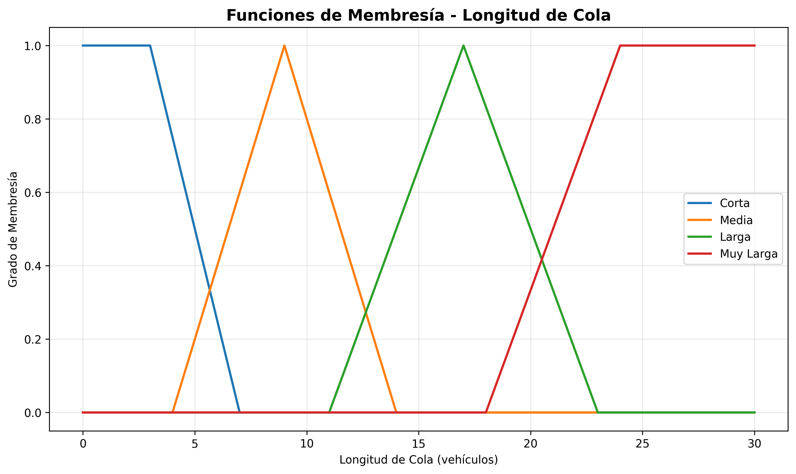
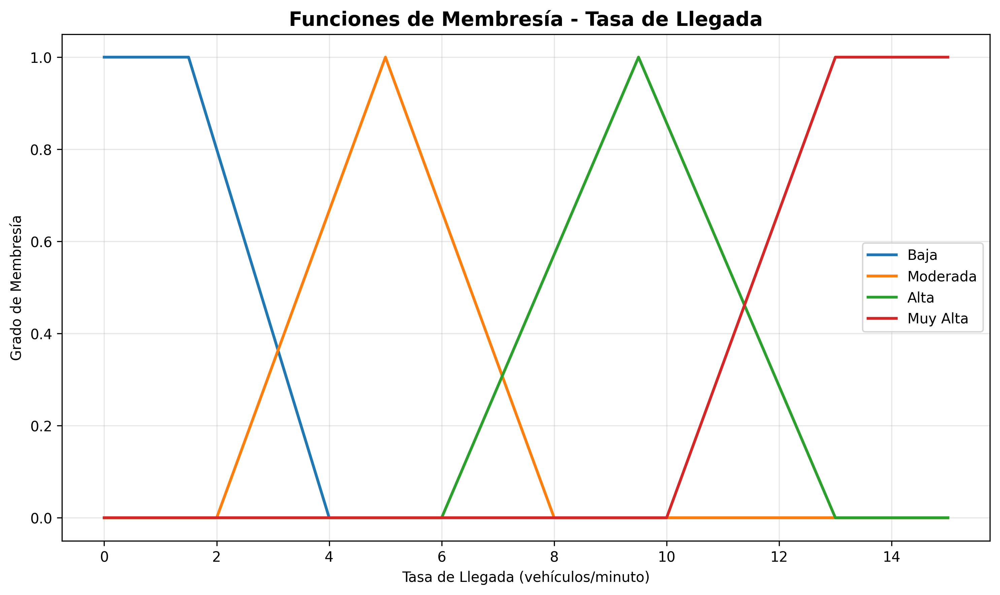
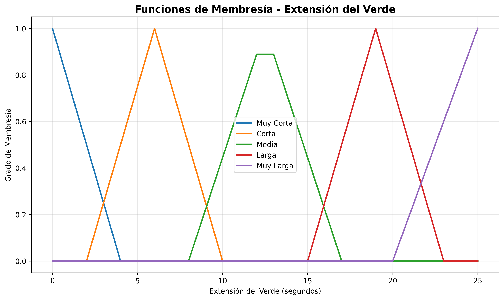

# Controlador previo de 16 reglas (archivado)

> **Archivado.** Este fue el primer controlador del proyecto (dos entradas, 16 reglas, centroide). El controlador vigente es la
> réplica de Pappis y Mamdani con **sus 25 reglas**, en la carpeta `codigo/` de la raíz del repositorio. Se conserva aquí solo como
> referencia; ejecute los comandos de este archivo desde esta carpeta.

## Descripción original

Controlador de **lógica difusa tipo Mamdani** que decide cuántos segundos extender el verde de un semáforo a partir de dos medidas del tráfico: la **longitud de la cola** y la **tasa de llegada** de vehículos. Está hecho con [`scikit-fuzzy`](https://github.com/scikit-fuzzy/scikit-fuzzy).

> **Autores:** Raul Nolberto Quispe Saya y Kevin Luis Valero Ccacya
> Escuela Profesional de Ingeniería Electrónica, Universidad Nacional de San Agustín de Arequipa.

## Contenido del repositorio

| Archivo / carpeta | Descripción |
|---|---|
| `flc_controlador.py` | El controlador: variables, funciones de membresía, base de reglas, función `calcular_extension()` y generación de las gráficas. |
| `CODIGOA1.py` | Prueba mínima: comprueba que `numpy`, `scikit-fuzzy` y `matplotlib` están instalados. |
| `requirements.txt` | Versiones de las librerías usadas. |
| `resultados/` | Gráficas de las funciones de membresía (se regeneran al ejecutar `flc_controlador.py`). |

## Instalación

Se necesita Python 3.10 o superior.

```bash
# Linux / macOS
python3 -m venv .venv
source .venv/bin/activate
python -m pip install -r requirements.txt
```

```powershell
# Windows (PowerShell)
python -m venv .venv
.venv\Scripts\activate
python -m pip install -r requirements.txt
```

Si PowerShell bloquea la activación del entorno, ejecute antes `Set-ExecutionPolicy -Scope Process -ExecutionPolicy Bypass`.

Para comprobar la instalación:

```bash
python CODIGOA1.py
```

## Uso

### Ejecutar el ejemplo

```bash
python flc_controlador.py
```

Calcula la extensión del verde para cuatro casos de prueba y guarda las tres gráficas de membresía en `resultados/`. Salida esperada:

```
  Cola (veh)   Llegada (veh/min)  Extensión (s)
--------------------------------------------------
           2                   1           1.33
          10                   6          12.50
          20                  11          23.06
          28                  14          23.33
```

### Usarlo desde otro programa

```python
from flc_controlador import calcular_extension

extension = calcular_extension(cola_actual=10, tasa_llegada=6)   # 12.5 segundos
```

> Al importar el módulo se crea la carpeta `resultados/` junto al código si no existe.

## Cómo funciona

### Variables

| Variable | Tipo | Universo | Etiquetas |
|---|---|---|---|
| Longitud de cola `Q` | entrada | 0 a 30 vehículos | corta, media, larga, muy larga |
| Tasa de llegada `A` | entrada | 0 a 15 veh/min | baja, moderada, alta, muy alta |
| Extensión del verde `E` | salida | 0 a 25 s | muy corta, corta, media, larga, muy larga |

### Funciones de membresía

Los parámetros están en la sección 2 de `flc_controlador.py` (`trimf` = triangular, `trapmf` = trapezoidal).

| Cola `Q` | Parámetros | Llegada `A` | Parámetros | Extensión `E` | Parámetros |
|---|---|---|---|---|---|
| corta | trap `[0, 0, 3, 7]` | baja | trap `[0, 0, 1.5, 4]` | muy corta | tri `[0, 0, 4]` |
| media | tri `[4, 9, 14]` | moderada | tri `[2, 5, 8]` | corta | tri `[2, 6, 10]` |
| larga | tri `[11, 17, 23]` | alta | tri `[6, 9.5, 13]` | media | tri `[8, 12.5, 17]` |
| muy larga | trap `[18, 24, 30, 30]` | muy alta | trap `[10, 13, 15, 15]` | larga | tri `[15, 19, 23]` |
| | | | | muy larga | tri `[20, 25, 25]` |





### Base de reglas

Son 16 reglas, la combinación completa de las 4 etiquetas de cola con las 4 de llegada (`Q y A → E`):

| Cola \ Llegada | baja | moderada | alta | muy alta |
|---|---|---|---|---|
| **corta** | muy corta | corta | media | media |
| **media** | corta | media | larga | larga |
| **larga** | media | larga | muy larga | muy larga |
| **muy larga** | larga | muy larga | muy larga | muy larga |

### Inferencia y defuzzificación

- Conectivo «y» = mínimo; agregación de las reglas = máximo (inferencia de Mamdani, la que usa `scikit-fuzzy` por defecto).
- Defuzzificación por **centroide** (`E.defuzzify_method = 'centroid'`).

## Relación con Pappis y Mamdani (1977)

El controlador se inspira en el trabajo de Pappis y Mamdani sobre el control difuso de una intersección, pero no es una réplica exacta: aquel usa 25 reglas (cinco por cada momento de intervención), tres entradas (tiempo, arribos y cola), extensiones de 1 a 10 s y decide por máximo con umbral 0.5 en lugar de centroide. Este proyecto usa dos entradas, 16 reglas y extensiones de 0 a 25 s.

## Reproducibilidad

- `requirements.txt` fija las versiones usadas.
- El controlador es determinista: las mismas entradas dan siempre la misma extensión.
- Las gráficas de `resultados/` se pueden regenerar con `python flc_controlador.py`.
